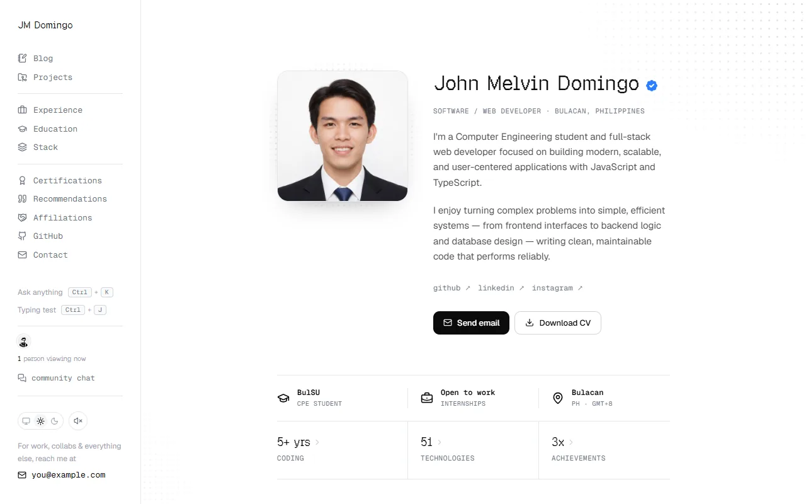

<div align="center">

# John Melvin Domingo — Portfolio

**Personal developer portfolio, interactive resume, and automated CV pipeline.**  
Built with React 19, TypeScript, Tailwind CSS v4, Framer Motion, and Vite.

[](https://github.com/constMelvin/portfolio/actions/workflows/sync.yml)


<br />



</div>

---

## Overview

This repository hosts my personal software engineering portfolio. Everything on the website—and the downloadable one-page PDF resume behind the **Download CV** button—is driven by a single typed data source (`src/data/portfolio.ts`) so the website and resume never drift out of sync.

### Key Highlights

- **Single Source of Truth:** Profile details, work experience, projects, tech stack, and education live in `src/data/portfolio.ts`.
- **Automated Resume Engine:** `scripts/cv/build_cv.py` compiles `src/data/cv.ts` directly into a formatted Word document (`cv/John-Melvin-Domingo-CV.docx`) and exports a one-page PDF (`public/John-Melvin-Domingo-CV.pdf`) via Microsoft Word (local Windows) or LibreOffice (CI).
- **Private + Public GitHub Activity Graph:** `scripts/sync-github.mjs` queries the GitHub GraphQL API to aggregate daily contribution counts across both public and private repositories into `public/github-activity.json` without exposing private repository names or code.
- **Interactive Experience:** Includes a keyboard-first command palette (`Ctrl/⌘ + K`), animated dark/light theme switching, guided site tour, interactive widgets, and dedicated routes for projects, experience, stack, certifications, and blog posts.

---

## Tech Stack

| Category | Technologies |
| :--- | :--- |
| **Framework & Language** | React 19, TypeScript 5.9, React Router v7 |
| **Styling & UI** | Tailwind CSS v4, Radix UI, shadcn/ui, Lucide Icons, Geist & Geist Mono |
| **Animation** | Framer Motion, `tw-animate-css` |
| **Build & Tooling** | Vite 7, ESLint 9, Node.js, Python 3 (CV builder) |
| **Deployment & CI/CD** | Vercel (SPA hosting), GitHub Actions (automated CV & contribution sync) |

---

## Project Structure

```text
├── .github/workflows/
│   └── sync.yml                  # CI workflow: auto-builds CV on push & syncs GitHub graph daily
├── cv/
│   ├── .cv-hash                  # Content hash to detect when CV data has changed
│   └── John-Melvin-Domingo-CV.docx
├── public/
│   ├── projects/                 # Project preview screenshots (.webp)
│   ├── github-activity.json      # Synced GitHub contribution dataset
│   └── John-Melvin-Domingo-CV.pdf
├── scripts/
│   ├── cv/
│   │   ├── build_cv.py           # Generates .docx and exports .pdf via Word or LibreOffice
│   │   ├── check.mjs             # Pre-build check warning if CV is out of sync with site data
│   │   ├── data.mjs              # Extracts and hashes CV payload from src/data/cv.ts
│   │   └── template.docx         # Base Word template with embedded typography & styles
│   └── sync-github.mjs           # Fetches 1-year contribution history via GitHub CLI GraphQL
├── src/
│   ├── components/               # Page layouts, interactive cards, modals, command palette, UI
│   ├── data/
│   │   ├── portfolio.ts          # Primary content file (profile, projects, experience, stack)
│   │   └── cv.ts                 # Maps portfolio.ts entries into structured resume sections
│   ├── lib/                      # Utilities, sound effects, and overlay state
│   ├── App.tsx                   # Application routes
│   └── main.tsx                  # Entry point
└── vercel.json                   # SPA fallback rewrites for Vercel deployment
```

---

## Getting Started

### Prerequisites

- **Node.js** `>= 22.6` (uses `--experimental-strip-types` for CV scripts)
- **Python** `>= 3.10` *(optional, only required to regenerate the CV locally)*
- **Microsoft Word** (Windows) or **LibreOffice** *(optional, for local DOCX → PDF conversion)*
- **GitHub CLI (`gh`)** *(optional, authenticated via `gh auth login` to sync the GitHub graph locally)*

### Local Development

```bash
# 1. Install dependencies
npm install

# 2. Start the development server (http://localhost:5173)
npm run dev

# 3. Type-check and build for production
npm run build

# 4. Preview the production build locally
npm run preview
```

---

## Updating Content & Routine Workflow

All portfolio content is managed in **`src/data/portfolio.ts`**.

### Available Scripts

| Command | Description |
| :--- | :--- |
| `npm run dev` | Starts the local Vite dev server with hot reload |
| `npm run cv` | Regenerates `cv/John-Melvin-Domingo-CV.docx` and `public/John-Melvin-Domingo-CV.pdf` |
| `npm run github:sync` | Refreshes `public/github-activity.json` across public and private repos |
| `npm run sync` | Runs both `github:sync` and `cv` |
| `npm run build` | Runs prebuild CV sync check, TypeScript compiler (`tsc -b`), and `vite build` |
| `npm run lint` | Runs ESLint across the project |

### Controlling What Appears on the CV

When adding items to `experience`, `education`, or `projects` in `src/data/portfolio.ts`:
- **Default behavior:** Entries are automatically included in the generated CV.
- **Custom CV bullets:** Add `cv: ["Bullet 1", "Bullet 2"]` on an entry to use tailored resume bullet points while keeping a shorter description on the website.
- **Exclude from CV:** Set `cv: false` on any entry to display it on the website without taking up space on the one-page PDF resume.

---

## Production & CI/CD Pipeline

1. **Continuous Deployment (Vercel):**
   - Pushing to the `main` branch automatically triggers a Vercel production build (`npm run build`) and deploys the `dist/` output.
2. **Automated CV & Graph Sync (`.github/workflows/sync.yml`):**
   - **On Push to `main`** (when `src/data/**` or `scripts/cv/**` changes): GitHub Actions installs LibreOffice + template fonts, regenerates the CV if the content hash changed (`npm run cv -- --if-changed`), and commits the updated `.docx` and `.pdf` back to `main`.
   - **Daily Schedule (`00:00 Asia/Manila`):** GitHub Actions runs `npm run github:sync` using the `GH_STATS_TOKEN` repository secret and commits the updated `public/github-activity.json`.

### Required GitHub Repository Settings

To enable the automated workflow in production:
1. **Repository Secret (`GH_STATS_TOKEN`):** Create a fine-grained Personal Access Token with **All repositories** access and **Contents: Read-only** permission, then save it under **Settings → Secrets and variables → Actions → `GH_STATS_TOKEN`**.
2. **Workflow Permissions:** Enable **Read and write permissions** under **Settings → Actions → General → Workflow permissions** so `github-actions[bot]` can commit updated assets.

---

## Contact

**John Melvin Domingo** — Software / Web Developer (Bulacan, Philippines)

- **GitHub:** [@constMelvin](https://github.com/constMelvin)
- **Email:** [domingo.jm029@gmail.com](mailto:domingo.jm029@gmail.com)
